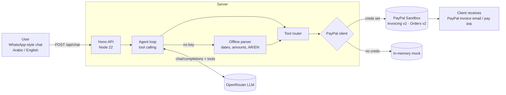

# Architecture

Tools exposed to the model: `create_invoice` (create + send), `send_invoice`, `remind_invoice`,
`get_invoice_status`, `list_invoices` (used for AI unpaid-invoice summaries), `create_payment_link` (Orders v2 approve URL).
